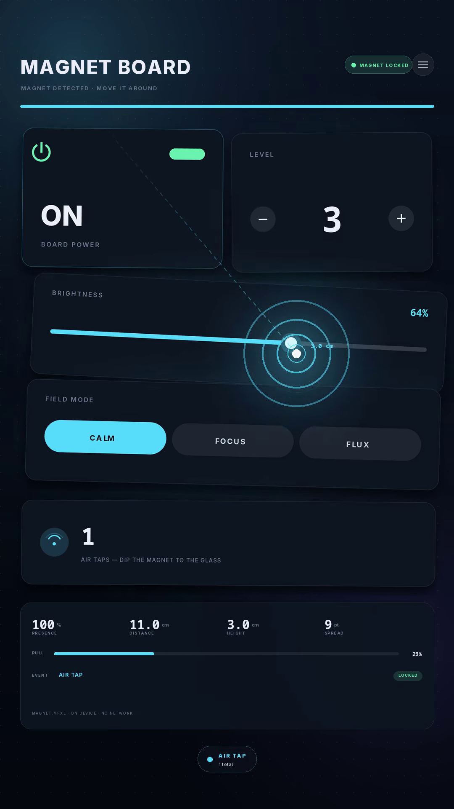

# Magnet Board

[](promo/magnetboard-promo.webm)

**[Download the unsigned .ipa](https://github.com/1ucent/MagnetBoard/releases/latest)** ·
[watch the 15 s promo](promo/magnetboard-promo.webm)

> The release build is compiled by CI, which has no `Magnet.mfxl` (licence), so
> it runs in demo mode. Build locally with the model for the real magnet.

A small SwiftUI iPhone app whose whole interface **leans toward a real magnet**.

Hold a fridge magnet (a small neodymium ring works best) about 2 cm above the
screen and the tiles get pulled toward it, tilt, and glow hotter the closer it
gets. Move it around and the board follows; take it away and everything springs
back. Dip the magnet toward the glass and the app counts an **air tap**.

The sensing is done by [Magnetic UI / MagnetKit](https://libraries.dev/magnetic)
from Libraries.dev: a ~1 MB on-device model that reads the magnetometer, locates
the magnet on the screen (median error ~1.2 cm), decides whether it is really
there, and recognises air taps. No permission prompt, no network.

```
Magnet app  ──►  MagnetKit (Magnet.mfxl, Accelerate)  ──►  MagnetFrame  ──►  SwiftUI
                 position · presence · pull · toward              tiles, Canvas, HUD
```

## What's inside

| File | Role |
|---|---|
| `MagnetBoardApp.swift` | `@main`, owns the single `MagnetEngine`, dark nav appearance |
| `MagnetEngine.swift` | **The only file that talks to MagnetKit.** Config, `attach`/`detach`/`calibrate`, one `MagnetFrame` per refresh, gesture events, haptics, and a finger-driven demo magnet |
| `ContentView.swift` | The board: `TimelineView(.animation)` → header, presence meter, tiles, status pill, demo puck, event banner |
| `MagneticTile.swift` | Wraps any control, measures itself, applies offset / tilt / scale / glow from the frame |
| `EdgeGather.swift` | Works out which screen edge the magnet is at (or is pointing at) and gathers the board toward it |
| `ParticleField.swift` | `Canvas` dust stream that flows to the magnet and piles up at the edge |
| `BoardControls.swift` | Power switch, level stepper, brightness slider, segmented field-mode chips, air-tap counter |
| `FieldOverlay.swift` | `Canvas` beam from the magnetometer to the magnet, 1-σ spread ring, pulsing puck, tap ripples |
| `HUDView.swift` | Presence, distance, height, spread, pull, too-close warning |
| `SettingsSheet.swift` | Demo mode, magnet north face, recalibrate, model setup notes |
| `Theme.swift` | Palette, metrics, shared card surface |
| `tools/make_icon.py` | Regenerates `AppIcon-1024.png` (pure Python, no dependencies) |
| `tools/make_promo.py` | Renders the promo video: Pillow frames piped to ffmpeg, clicky audio synthesised with numpy |
| `promo/magnetboard-promo.webm` | The 15 s, 1080×1920 promo (VP9 + Opus) |
| `release.sh` | Build the `.ipa`, tag, create a GitHub Release, upload the ipa + sha256 |

## Requirements

- iOS **17.0+**, Xcode **15+**
- A physical iPhone (the Simulator has no magnetometer — use demo mode there)
- A magnet. Any fridge magnet works; a small neodymium ring is best

## Getting started

1. **Open `MagnetBoard.xcodeproj`.** The Swift package is already referenced
   (`https://github.com/Jakubantalik/Libraries.dev`, branch `main`, product
   `MagnetKit`); Xcode resolves it on first open.
2. **Add the model.** Download `Magnet.mfxl` (2 MB) from
   [libraries.dev/magnetic](https://libraries.dev/magnetic) → **Model**, then drag
   it into the `MagnetBoard` group and tick **Copy Bundle Resources**.

   The model is *not* in the Swift package. Without it the app still builds and
   runs, shows **NO MODEL** in the status pill, and demo mode still works.
3. Pick your Team under **Signing & Capabilities**, then run on your iPhone.

`./build_ipa.sh` produces an unsigned `build/MagnetBoard.ipa` for AltStore /
Sideloadly / TrollStore. Set `TEAM_ID=…` to sign instead.

## Using it

| Gesture | What happens |
|---|---|
| Hold the magnet over the board | Tiles pull toward it, tilt, and glow; the beam and puck follow |
| Move it closer / farther | `pull` grows / shrinks, the glow and background respond |
| Dip it quickly toward the glass | Counted as an **air tap** — ripple, haptic, counter +1 |
| Dart toward / yank away | `PUSH` / `PULLED AWAY` banner with the speed in cm/s |
| Swipe across the screen fast | `SWIPE` banner (above 1,500 pt/s) |
| Keep it too close | **TOO CLOSE** warning — past ~2,000 µT the phone gets magnetised |
| Hold it at / past an edge | The whole board gathers to that edge and the particles pile up there |

Settings (top-right) has **Demo magnet** for the Simulator: drag the orange puck,
tap it for an air tap. Leaving demo mode re-attaches the real magnetometer.

## Gathering to the edge

The board's original idea: when the magnet is at (or just past) an edge of the
screen, the whole UI comes to it. `EdgeGather` picks the edge and the point along
it, and `EdgeGatherEffect` shrinks the board toward that point, so the cards pile
up against the edge where the magnet is — and spring back out when it leaves.

It works with the magnet **beside** the phone too: when the locator has no
position, the kit's `toward` unit vector picks the edge, and `pull` sets the
strength, so the UI still gathers even though the magnet never touches the glass.

`ParticleField` is the other half: ~88 dust motes whose positions are a pure
function of time and presence, so nothing accumulates frame to frame. They drift
when the board is idle and stream into the magnet when it is near, forming a
dense pile at the edge when the magnet is held off-screen. Both behaviours have
toggles in **Settings → Motion**, stored in `@AppStorage`.

## How the library is used

MagnetKit's own API, exactly as documented:

```swift
let magnet = MagnetSource.shared
magnet.config.locatorEnabled = true
magnet.config.sensorPosition = CGPoint(x: 70, y: 86)   // magnetometer, window points
magnet.config.magnetFace = 1                            // +1 north toward the user
magnet.attach()                                         // onAppear; detach() on disappear

let r = magnet.reading(now: now)                        // once per TimelineView frame
r.screenPosition   // CGPoint?  global points
r.screenSpread     // 1-σ uncertainty, points
r.height           // cm above the glass
r.presence         // 0…1 is a magnet really there
r.pull, r.toward   // closeness and unit direction (works without the locator)
r.distance, r.approachSpeed, r.tooClose, r.calibrating

magnet.addGestureHandler { g in
    switch g {
    case .tap(let at): break          // at: global points
    case .push(let speed): break      // cm/s
    case .pullAway(let speed): break  // cm/s
    case .swipe(let dir, let speed): break
    }
}
```

The app maps that onto a single plain struct per frame, so the views are cheap
and the magnet maths lives in one place:

```swift
func influence(at center: CGPoint, reach: CGFloat) -> CGFloat {
    guard let position else { return 0 }
    let d = max(1, hypot(position.x - center.x, position.y - center.y))
    let near = max(0, 1 - d / reach)
    return CGFloat(presence) * near * near      // presence fades effects out
}
```

## Tuning

- **Sensor spot** — `MagnetSupport.sensorPosition` in `MagnetEngine.swift` is for an
  iPhone 15 Pro (70, 86 pt). Move it a few points for another model.
- **Reach / travel / tilt** — per-tile arguments on `MagneticTile` (`reach`,
  `travel`, `tilt`, `glow`); defaults come from `Theme.reach`.
- **Magnet face** — Settings → *North pole faces the screen* flips
  `config.magnetFace` if the puck mirrors your hand.
- **Recalibrate** after putting the phone on a steel table, a laptop or a MagSafe
  puck — those shift the phone's own field.

## Promo video

`promo/magnetboard-promo.webm` — 15 s, 1080×1920 (9:16), VP9 video + Opus audio,
about 1.3 MB. Nothing was screen-recorded: the board is re-drawn frame by frame
with the same palette and the same pull maths as `MagneticTile.swift`, and every
click, thump and whoosh is synthesised, so there are no samples or music
licensing to worry about.

Beats: title → board arrives → the magnet sweeps the tiles (a click as it passes
each one) → an air tap (click-clack, ripple, counter goes to 1) → yanked away →
outro.

```sh
python3 -m venv .venv && .venv/bin/pip install pillow numpy
.venv/bin/python tools/make_promo.py            # full render (~1 min)
.venv/bin/python tools/make_promo.py --stills   # review PNGs instead
```

## Releasing

```sh
./release.sh 1.0.0               # build on macOS, tag v1.0.0, create the release, upload
./release.sh 1.0.0 --skip-build  # upload an existing build/MagnetBoard.ipa
./release.sh 1.0.0 --draft       # keep it hidden until you publish it
./release.sh 1.0.0 --dry-run     # show what it would do
```

It uploads `MagnetBoard.ipa` plus `MagnetBoard.ipa.sha256`, writes release notes
with the checksum, and re-running for the same tag replaces the assets, so a
rebuild is safe. Auth, in order: `$GH_TOKEN`, `gh auth token`, or the credential
git already stores for github.com.

`.github/workflows/release.yml` does the same on a `v*` tag with a macOS runner.
The model can't live in a public repo, so add it as a base64 secret
`MAGNET_MODEL_B64` (`base64 -i Magnet.mfxl`) — without it the CI build falls back
to demo mode.

## Licensing

- App code in this repository: yours to use.
- **MagnetKit code**: MIT.
- **`Magnet.mfxl` model**: Libraries.dev Model License — free for development,
  prototypes and non-commercial apps. A commercial release needs a Libraries.dev
  plan. Ship the file inside the app bundle, never in a public repository.

## Note on verification

This was written on Linux, where Xcode is unavailable, so the project has not
been compiled here. The Xcode project, plists, asset catalogs and scheme were
checked structurally (brace/paren balance, every object ID resolved, JSON/plist
valid), and the Swift sources were reviewed against the published MagnetKit API.
If the package layout ever changes, the `#if canImport(MagnetKit)` guards mean
you get a build with the demo puck instead of a wall of errors.
